# State Machines (generated)

<!-- Generated by `UPDATE_STATE_MACHINES=1 cargo test -p stateset-core --test state_machine_catalog`. Do not edit. -->

Every catalogued status lifecycle (`stateset_core::StateMachine`). Two kinds of rule are published: machines whose enum owns its transition rule (`can_transition_to`), and machines whose rule the repositories enforce inline, written down as tables (`stateset_core::state_machine::repository_rules`). The second kind is proven by a conformance suite that drives the real repository operations through every move on SQLite and Postgres (`crates/stateset-db/tests/*_state_machine_conformance.rs`), so both are what the engine will accept.

A status reached only through an operation (shipping an order, capturing a payment) still needs that operation; a plain status update may be refused even where an edge exists here.

Ask the same question at runtime:

- Rust: `OrderStatus::Pending.next_states()`, `.check_transition(next)`, `stateset_core::state_machine::catalog()`
- MCP / agents: the `explain_state_machine` tool
- CLI: `stateset explain state-machine machine=order from=pending to=delivered`

| Machine | Domain | Rust type | Rule | Initial | Terminal states |
| --- | --- | --- | --- | --- | --- |
| [`order`](#order) | orders | `OrderStatus` | enum | `pending` | cancelled, refunded |
| [`cart`](#cart) | carts | `CartStatus` | enum | `active` | completed, abandoned, cancelled, expired |
| [`payment`](#payment) | payments | `PaymentTransactionStatus` | enum | `pending` | failed, cancelled, refunded |
| [`refund`](#refund) | payments | `RefundStatus` | enum | `pending` | completed, failed, cancelled |
| [`return`](#return) | returns | `ReturnStatus` | enum | `requested` | rejected, completed, cancelled |
| [`shipment`](#shipment) | shipments | `ShipmentStatus` | enum | `pending` | returned, cancelled |
| [`customer`](#customer) | customers | `CustomerStatus` | enum | `active` | deleted |
| [`product`](#product) | products | `ProductStatus` | enum | `draft` | archived |
| [`subscription`](#subscription) | subscriptions | `SubscriptionStatus` | enum | `active` | cancelled, expired |
| [`subscription_plan`](#subscription_plan) | subscriptions | `PlanStatus` | enum | `active` | archived |
| [`billing_cycle`](#billing_cycle) | subscriptions | `BillingCycleStatus` | enum | `scheduled` | refunded, voided |
| [`purchase_order`](#purchase_order) | purchase_orders | `PurchaseOrderStatus` | enum | `draft` | completed, cancelled |
| [`work_order`](#work_order) | manufacturing | `WorkOrderStatus` | enum | `planned` | completed, cancelled |
| [`cycle_count`](#cycle_count) | inventory | `CycleCountStatus` | enum | `draft` | completed, cancelled |
| [`lot`](#lot) | lots | `LotStatus` | enum | `active` | consumed, scrapped |
| [`serial`](#serial) | serials | `SerialStatus` | enum | `available` | scrapped |
| [`fixed_asset`](#fixed_asset) | fixed_assets | `FixedAssetStatus` | enum | `draft` | disposed, written_off |
| [`revenue_contract`](#revenue_contract) | revenue_recognition | `RevenueContractStatus` | enum | `draft` | completed, cancelled |
| [`revenue_entry`](#revenue_entry) | revenue_recognition | `RevenueEntryStatus` | enum | `deferred` | recognized |
| [`a2a_payment`](#a2a_payment) | a2a | `A2APaymentStatus` | enum | `pending` | cancelled, refunded |
| [`a2a_payment_request`](#a2a_payment_request) | a2a | `PaymentRequestStatus` | enum | `pending` | paid, declined, expired, cancelled |
| [`a2a_quote`](#a2a_quote) | a2a | `A2AQuoteStatus` | enum | `requested` | declined, expired, fulfilled, cancelled |
| [`warranty_claim`](#warranty_claim) | warranties | `ClaimStatus` | enum | `submitted` | denied, completed, cancelled |
| [`skill_quote`](#skill_quote) | a2a | `QuoteStatus` | enum | `pending` | rejected, expired, purchased |
| [`skill_purchase`](#skill_purchase) | a2a | `PurchaseStatus` | enum | `initiated` | completed, cancelled, disputed |
| [`vendor_return`](#vendor_return) | vendor_returns | `VendorReturnStatus` | repositories | `draft` | processed, cancelled |
| [`transfer_order`](#transfer_order) | transfer_orders | `TransferOrderStatus` | repositories | `draft` | received, cancelled |
| [`edi_document`](#edi_document) | edi_documents | `EdiStatus` | repositories | `pending` | acknowledged, processed |
| [`receipt`](#receipt) | receiving | `ReceiptStatus` | repositories | `expected` | received, inspecting, putting_away, completed, cancelled |
| [`put_away`](#put_away) | receiving | `PutAwayStatus` | repositories | `pending` | completed, cancelled |
| [`wave`](#wave) | fulfillment | `WaveStatus` | repositories | `draft` | completed, cancelled |
| [`pick_task`](#pick_task) | fulfillment | `PickStatus` | repositories | `pending` | completed, short, cancelled |
| [`bom`](#bom) | manufacturing | `BomStatus` | repositories | `draft` | obsolete |
| [`bill`](#bill) | accounts_payable | `BillStatus` | repositories | `draft` | cancelled |
| [`bill_payment`](#bill_payment) | accounts_payable | `PaymentStatusAP` | repositories | `pending` | voided |
| [`payment_run`](#payment_run) | accounts_payable | `PaymentRunStatus` | repositories | `draft` | processing, completed, cancelled |
| [`credit_memo`](#credit_memo) | accounts_receivable | `CreditMemoStatus` | repositories | `open` | fully_applied, voided |
| [`prepayment`](#prepayment) | prepayments | `PrepaymentStatus` | repositories | `open` | refunded, cancelled |
| [`vendor_credit`](#vendor_credit) | vendor_credits | `VendorCreditStatus` | repositories | `open` | cancelled |
| [`payment_obligation`](#payment_obligation) | payment_obligations | `PaymentObligationStatus` | repositories | `pending` | cancelled |
| [`gl_period`](#gl_period) | general_ledger | `PeriodStatus` | repositories | `future` | locked |
| [`journal_entry`](#journal_entry) | general_ledger | `JournalEntryStatus` | repositories | `draft` | pending, voided, reversed |
| [`credit_account`](#credit_account) | credit | `CreditAccountStatus` | repositories | `active` | closed |
| [`credit_hold`](#credit_hold) | credit | `CreditHoldStatus` | repositories | `active` | released, expired |
| [`cost_adjustment`](#cost_adjustment) | cost_accounting | `CostAdjustmentStatus` | repositories | `pending` | applied, rejected |

## order

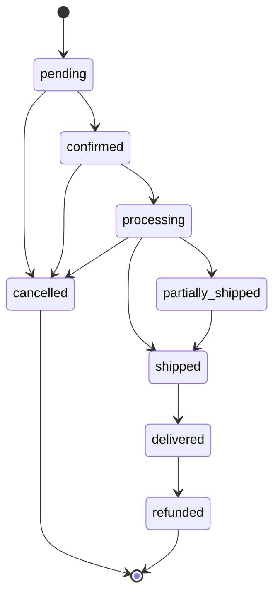

| From | Allowed next |
| --- | --- |
| `pending` | confirmed, cancelled |
| `confirmed` | processing, cancelled |
| `processing` | partially_shipped, shipped, cancelled |
| `partially_shipped` | shipped |
| `shipped` | delivered |
| `delivered` | refunded |
| `cancelled` | _terminal_ |
| `refunded` | _terminal_ |

## cart

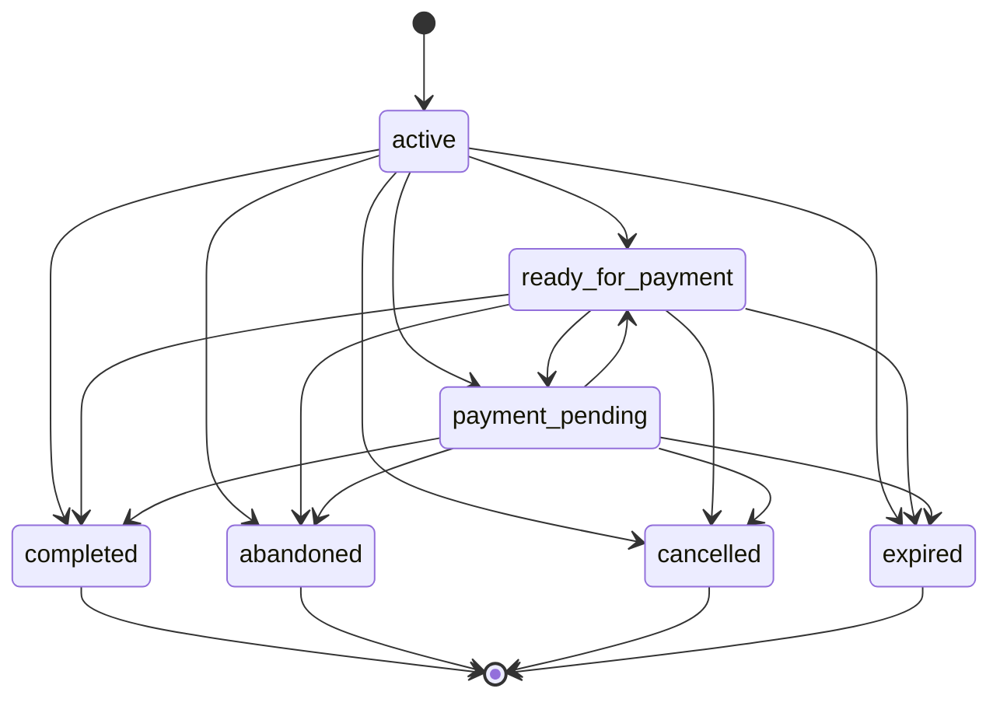

| From | Allowed next |
| --- | --- |
| `active` | ready_for_payment, payment_pending, completed, abandoned, cancelled, expired |
| `ready_for_payment` | payment_pending, completed, abandoned, cancelled, expired |
| `payment_pending` | ready_for_payment, completed, abandoned, cancelled, expired |
| `completed` | _terminal_ |
| `abandoned` | _terminal_ |
| `cancelled` | _terminal_ |
| `expired` | _terminal_ |

## payment

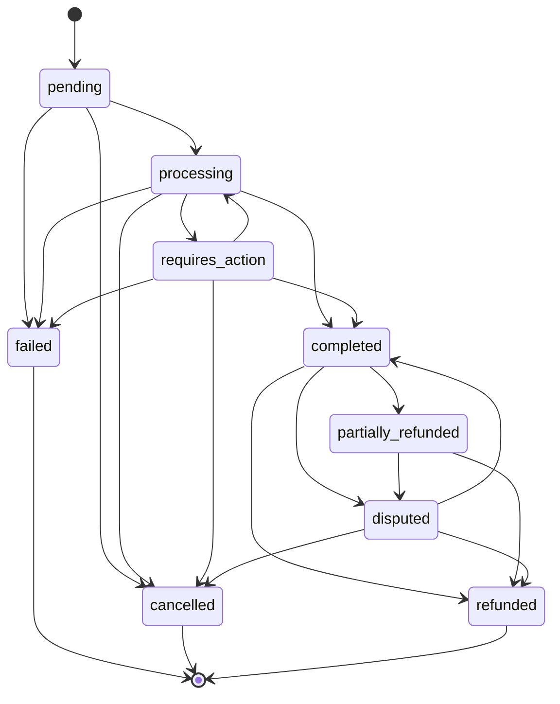

| From | Allowed next |
| --- | --- |
| `pending` | processing, failed, cancelled |
| `processing` | requires_action, completed, failed, cancelled |
| `requires_action` | processing, completed, failed, cancelled |
| `completed` | refunded, partially_refunded, disputed |
| `failed` | _terminal_ |
| `cancelled` | _terminal_ |
| `refunded` | _terminal_ |
| `partially_refunded` | refunded, disputed |
| `disputed` | completed, cancelled, refunded |

## refund

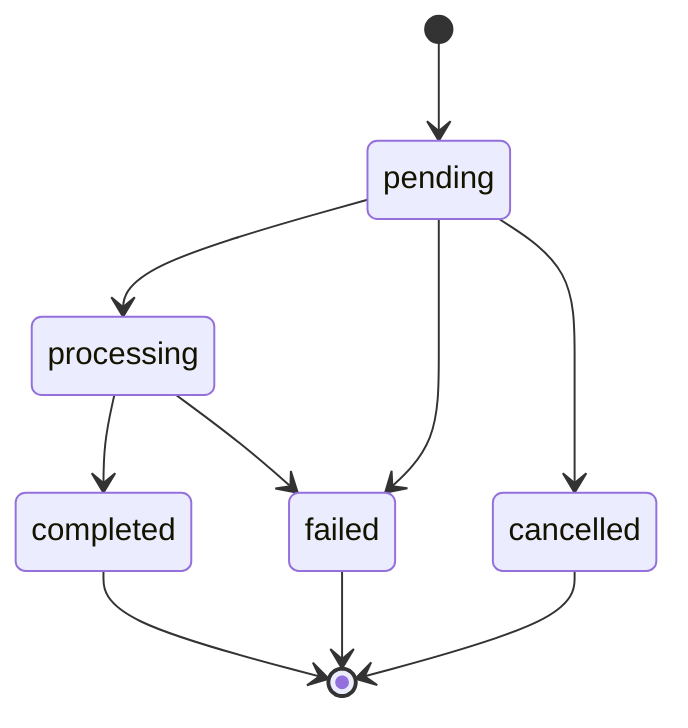

| From | Allowed next |
| --- | --- |
| `pending` | processing, failed, cancelled |
| `processing` | completed, failed |
| `completed` | _terminal_ |
| `failed` | _terminal_ |
| `cancelled` | _terminal_ |

## return

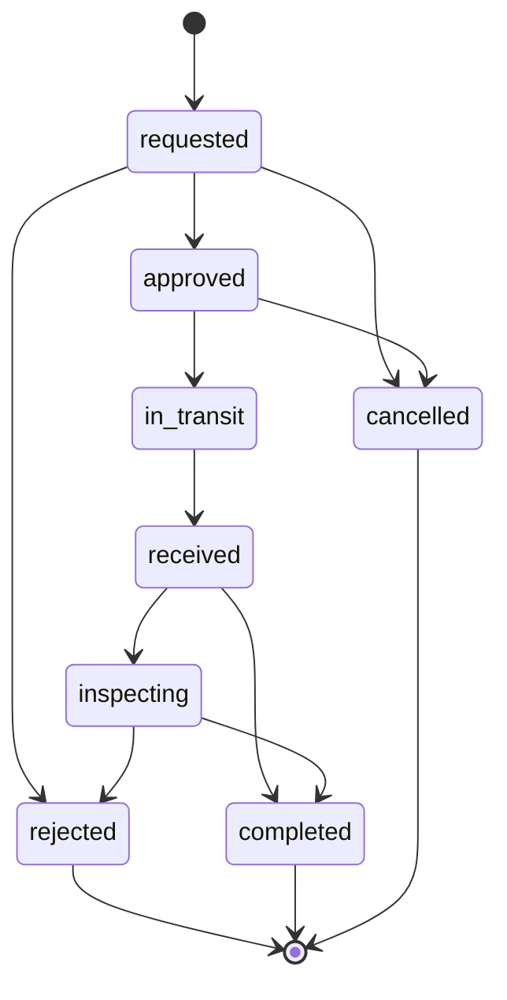

| From | Allowed next |
| --- | --- |
| `requested` | approved, rejected, cancelled |
| `approved` | in_transit, cancelled |
| `rejected` | _terminal_ |
| `in_transit` | received |
| `received` | inspecting, completed |
| `inspecting` | rejected, completed |
| `completed` | _terminal_ |
| `cancelled` | _terminal_ |

## shipment

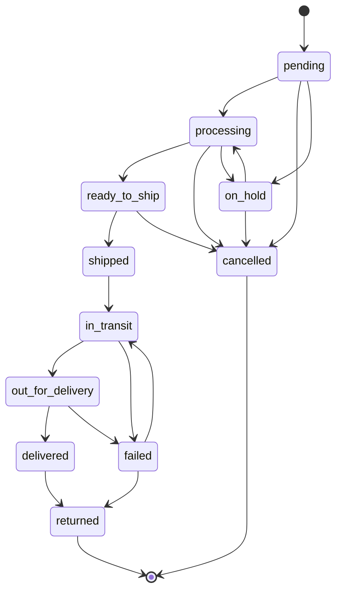

| From | Allowed next |
| --- | --- |
| `pending` | processing, cancelled, on_hold |
| `processing` | ready_to_ship, cancelled, on_hold |
| `ready_to_ship` | shipped, cancelled |
| `shipped` | in_transit |
| `in_transit` | out_for_delivery, failed |
| `out_for_delivery` | delivered, failed |
| `delivered` | returned |
| `failed` | in_transit, returned |
| `returned` | _terminal_ |
| `cancelled` | _terminal_ |
| `on_hold` | processing, cancelled |

## customer

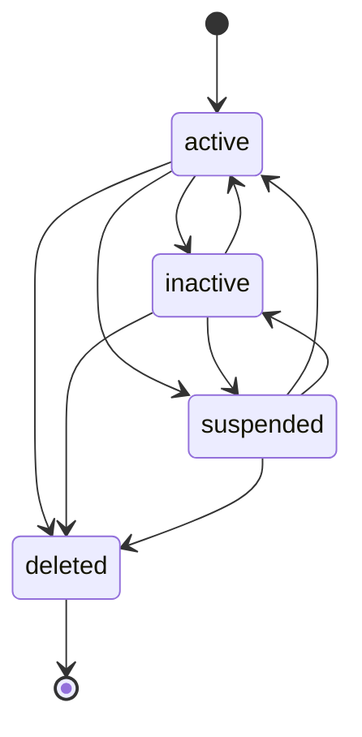

| From | Allowed next |
| --- | --- |
| `active` | inactive, suspended, deleted |
| `inactive` | active, suspended, deleted |
| `suspended` | active, inactive, deleted |
| `deleted` | _terminal_ |

## product

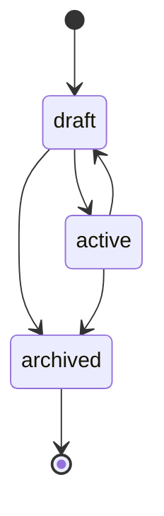

| From | Allowed next |
| --- | --- |
| `draft` | active, archived |
| `active` | draft, archived |
| `archived` | _terminal_ |

## subscription

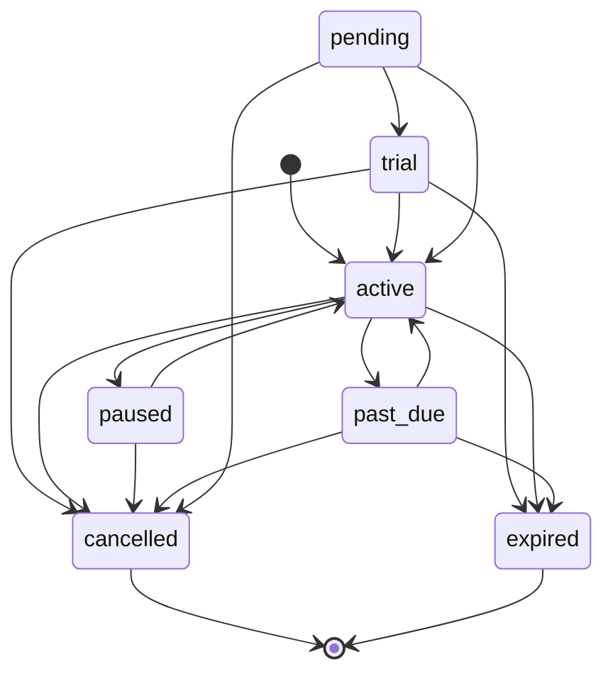

| From | Allowed next |
| --- | --- |
| `trial` | active, cancelled, expired |
| `active` | paused, past_due, cancelled, expired |
| `paused` | active, cancelled |
| `past_due` | active, cancelled, expired |
| `cancelled` | _terminal_ |
| `expired` | _terminal_ |
| `pending` | trial, active, cancelled |

## subscription_plan

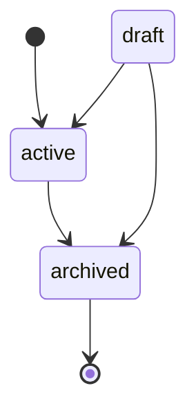

| From | Allowed next |
| --- | --- |
| `draft` | active, archived |
| `active` | archived |
| `archived` | _terminal_ |

## billing_cycle

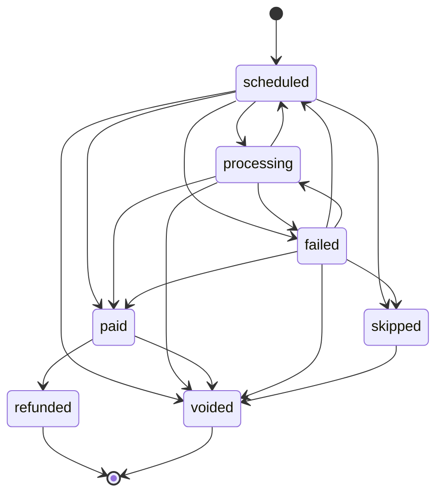

| From | Allowed next |
| --- | --- |
| `scheduled` | processing, paid, failed, skipped, voided |
| `processing` | scheduled, paid, failed, voided |
| `paid` | refunded, voided |
| `failed` | scheduled, processing, paid, skipped, voided |
| `skipped` | voided |
| `refunded` | _terminal_ |
| `voided` | _terminal_ |

## purchase_order

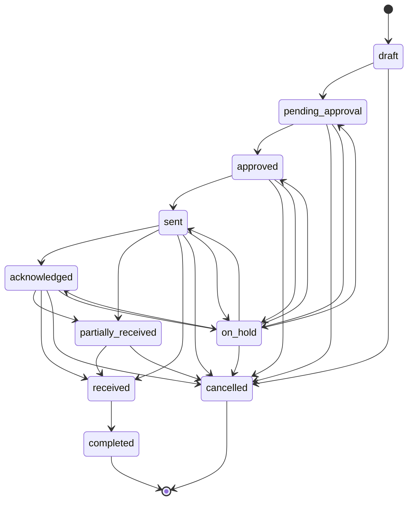

| From | Allowed next |
| --- | --- |
| `draft` | pending_approval, cancelled |
| `pending_approval` | approved, cancelled, on_hold |
| `approved` | sent, cancelled, on_hold |
| `sent` | acknowledged, partially_received, received, cancelled, on_hold |
| `acknowledged` | partially_received, received, cancelled, on_hold |
| `partially_received` | received, cancelled |
| `received` | completed |
| `completed` | _terminal_ |
| `cancelled` | _terminal_ |
| `on_hold` | pending_approval, approved, sent, acknowledged, cancelled |

## work_order

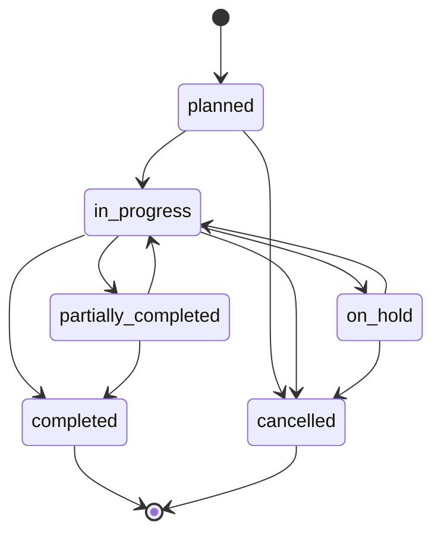

| From | Allowed next |
| --- | --- |
| `planned` | in_progress, cancelled |
| `in_progress` | completed, partially_completed, cancelled, on_hold |
| `completed` | _terminal_ |
| `partially_completed` | in_progress, completed |
| `cancelled` | _terminal_ |
| `on_hold` | in_progress, cancelled |

## cycle_count

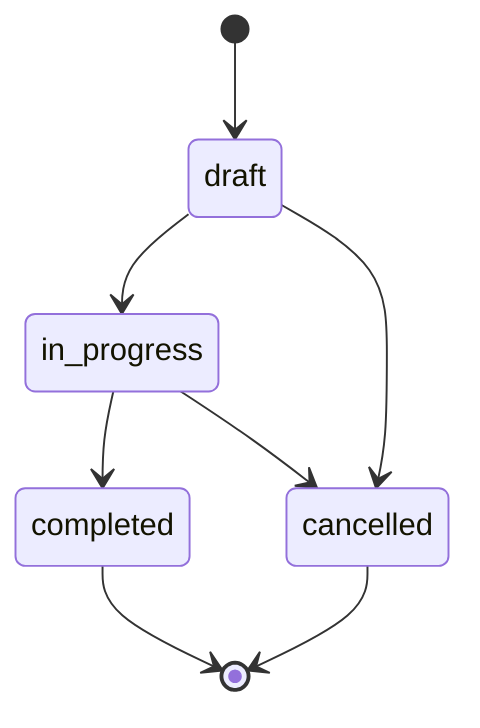

| From | Allowed next |
| --- | --- |
| `draft` | in_progress, cancelled |
| `in_progress` | completed, cancelled |
| `completed` | _terminal_ |
| `cancelled` | _terminal_ |

## lot

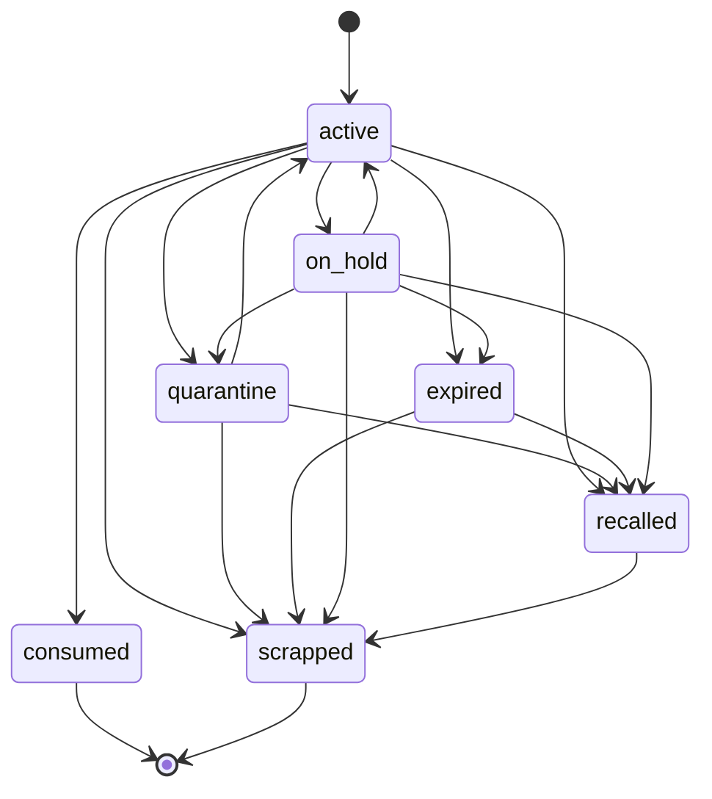

| From | Allowed next |
| --- | --- |
| `active` | quarantine, expired, consumed, on_hold, recalled, scrapped |
| `quarantine` | active, recalled, scrapped |
| `expired` | recalled, scrapped |
| `consumed` | _terminal_ |
| `on_hold` | active, quarantine, expired, recalled, scrapped |
| `recalled` | scrapped |
| `scrapped` | _terminal_ |

## serial

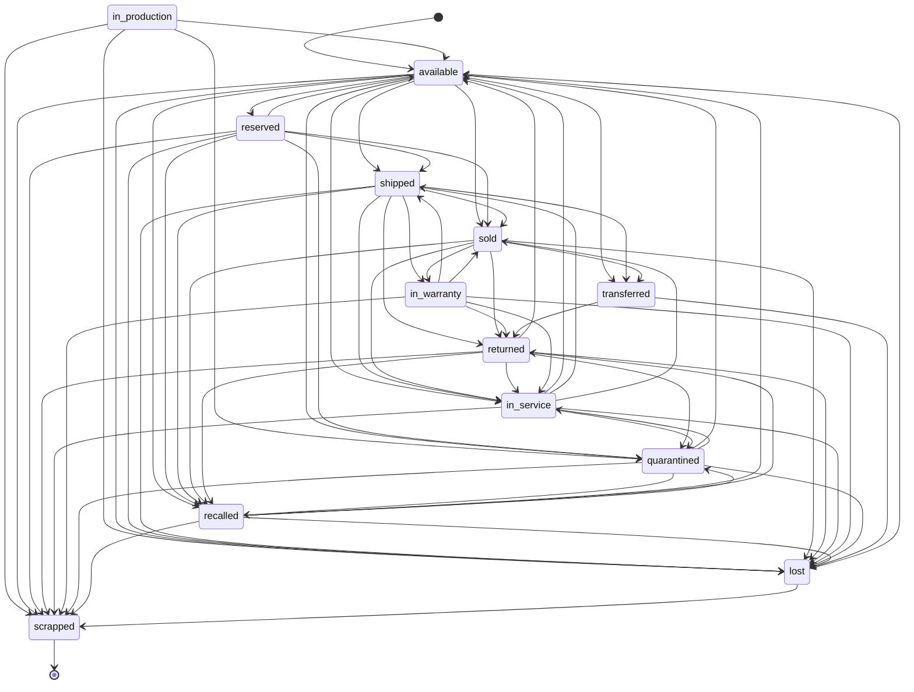

| From | Allowed next |
| --- | --- |
| `in_production` | available, quarantined, scrapped, lost |
| `available` | reserved, shipped, sold, in_service, quarantined, scrapped, recalled, lost, transferred |
| `reserved` | available, shipped, sold, quarantined, scrapped, recalled, lost |
| `shipped` | sold, returned, in_service, in_warranty, recalled, lost, transferred |
| `sold` | returned, in_service, in_warranty, recalled, lost, transferred |
| `returned` | available, in_service, quarantined, scrapped, recalled, lost |
| `in_service` | available, shipped, sold, quarantined, scrapped, lost |
| `in_warranty` | shipped, sold, returned, in_service, scrapped, lost |
| `quarantined` | available, in_service, scrapped, recalled, lost |
| `scrapped` | _terminal_ |
| `recalled` | available, returned, quarantined, scrapped, lost |
| `lost` | available, scrapped |
| `transferred` | returned, lost |

## fixed_asset

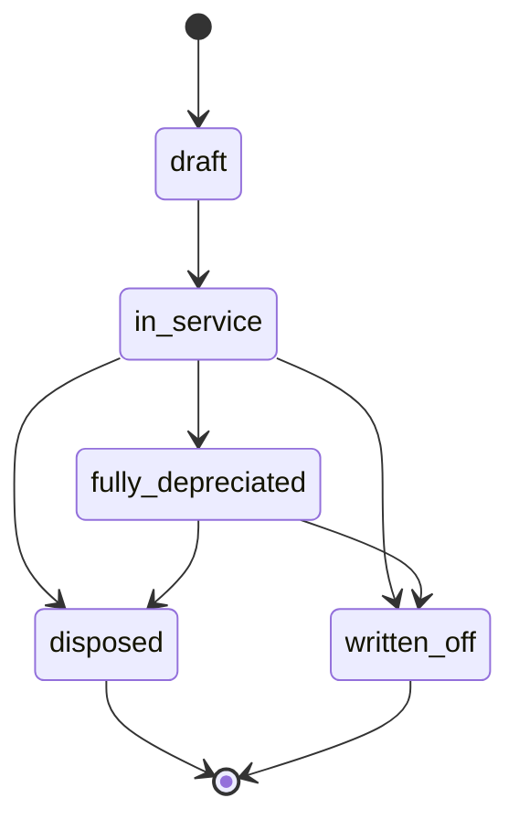

| From | Allowed next |
| --- | --- |
| `draft` | in_service |
| `in_service` | fully_depreciated, disposed, written_off |
| `fully_depreciated` | disposed, written_off |
| `disposed` | _terminal_ |
| `written_off` | _terminal_ |

## revenue_contract

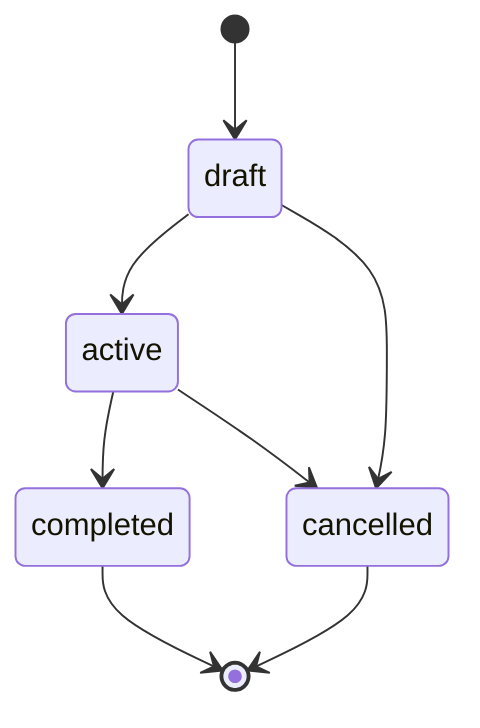

| From | Allowed next |
| --- | --- |
| `draft` | active, cancelled |
| `active` | completed, cancelled |
| `completed` | _terminal_ |
| `cancelled` | _terminal_ |

## revenue_entry

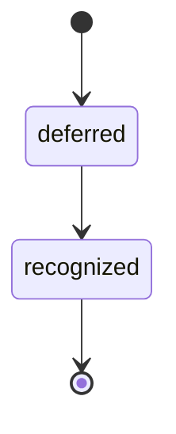

| From | Allowed next |
| --- | --- |
| `deferred` | recognized |
| `recognized` | _terminal_ |

## a2a_payment

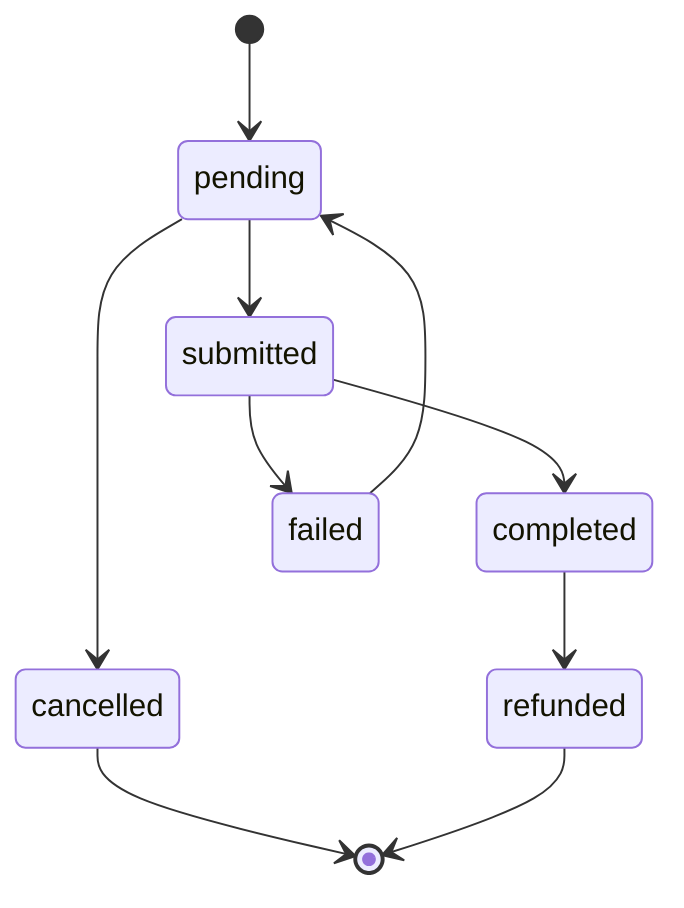

| From | Allowed next |
| --- | --- |
| `pending` | submitted, cancelled |
| `submitted` | completed, failed |
| `completed` | refunded |
| `failed` | pending |
| `cancelled` | _terminal_ |
| `refunded` | _terminal_ |

## a2a_payment_request

```mermaid
stateDiagram-v2
    [*] --> pending
    pending --> viewed
    pending --> processing
    pending --> declined
    pending --> expired
    pending --> cancelled
    viewed --> processing
    viewed --> declined
    viewed --> expired
    viewed --> cancelled
    processing --> paid
    processing --> declined
    paid --> [*]
    declined --> [*]
    expired --> [*]
    cancelled --> [*]
```

| From | Allowed next |
| --- | --- |
| `pending` | viewed, processing, declined, expired, cancelled |
| `viewed` | processing, declined, expired, cancelled |
| `processing` | paid, declined |
| `paid` | _terminal_ |
| `declined` | _terminal_ |
| `expired` | _terminal_ |
| `cancelled` | _terminal_ |

## a2a_quote

```mermaid
stateDiagram-v2
    [*] --> requested
    requested --> quoted
    requested --> expired
    requested --> cancelled
    quoted --> counter_offered
    quoted --> accepted
    quoted --> declined
    quoted --> expired
    quoted --> cancelled
    counter_offered --> quoted
    counter_offered --> accepted
    counter_offered --> declined
    counter_offered --> expired
    counter_offered --> cancelled
    accepted --> fulfilled
    accepted --> cancelled
    declined --> [*]
    expired --> [*]
    fulfilled --> [*]
    cancelled --> [*]
```

| From | Allowed next |
| --- | --- |
| `requested` | quoted, expired, cancelled |
| `quoted` | counter_offered, accepted, declined, expired, cancelled |
| `counter_offered` | quoted, accepted, declined, expired, cancelled |
| `accepted` | fulfilled, cancelled |
| `declined` | _terminal_ |
| `expired` | _terminal_ |
| `fulfilled` | _terminal_ |
| `cancelled` | _terminal_ |

## warranty_claim

```mermaid
stateDiagram-v2
    [*] --> submitted
    submitted --> under_review
    submitted --> info_requested
    submitted --> approved
    submitted --> denied
    submitted --> cancelled
    under_review --> info_requested
    under_review --> approved
    under_review --> denied
    under_review --> in_progress
    under_review --> cancelled
    info_requested --> under_review
    info_requested --> approved
    info_requested --> denied
    info_requested --> cancelled
    approved --> in_progress
    approved --> completed
    approved --> cancelled
    denied --> [*]
    in_progress --> completed
    in_progress --> cancelled
    completed --> [*]
    cancelled --> [*]
```

| From | Allowed next |
| --- | --- |
| `submitted` | under_review, info_requested, approved, denied, cancelled |
| `under_review` | info_requested, approved, denied, in_progress, cancelled |
| `info_requested` | under_review, approved, denied, cancelled |
| `approved` | in_progress, completed, cancelled |
| `denied` | _terminal_ |
| `in_progress` | completed, cancelled |
| `completed` | _terminal_ |
| `cancelled` | _terminal_ |

## skill_quote

```mermaid
stateDiagram-v2
    [*] --> pending
    pending --> quoted
    pending --> rejected
    pending --> expired
    quoted --> accepted
    quoted --> rejected
    quoted --> expired
    quoted --> purchased
    accepted --> purchased
    rejected --> [*]
    expired --> [*]
    purchased --> [*]
```

| From | Allowed next |
| --- | --- |
| `pending` | quoted, rejected, expired |
| `quoted` | accepted, rejected, expired, purchased |
| `accepted` | purchased |
| `rejected` | _terminal_ |
| `expired` | _terminal_ |
| `purchased` | _terminal_ |

## skill_purchase

```mermaid
stateDiagram-v2
    [*] --> initiated
    initiated --> payment_pending
    initiated --> cancelled
    initiated --> disputed
    payment_pending --> paid
    payment_pending --> shipped
    payment_pending --> cancelled
    payment_pending --> disputed
    paid --> fulfilling
    paid --> shipped
    paid --> completed
    paid --> cancelled
    paid --> disputed
    fulfilling --> shipped
    fulfilling --> cancelled
    fulfilling --> disputed
    shipped --> delivered
    shipped --> completed
    shipped --> cancelled
    shipped --> disputed
    delivered --> completed
    delivered --> cancelled
    delivered --> disputed
    completed --> [*]
    cancelled --> [*]
    disputed --> [*]
```

| From | Allowed next |
| --- | --- |
| `initiated` | payment_pending, cancelled, disputed |
| `payment_pending` | paid, shipped, cancelled, disputed |
| `paid` | fulfilling, shipped, completed, cancelled, disputed |
| `fulfilling` | shipped, cancelled, disputed |
| `shipped` | delivered, completed, cancelled, disputed |
| `delivered` | completed, cancelled, disputed |
| `completed` | _terminal_ |
| `cancelled` | _terminal_ |
| `disputed` | _terminal_ |

## vendor_return

```mermaid
stateDiagram-v2
    [*] --> draft
    draft --> pending
    draft --> cancelled
    pending --> processed
    pending --> cancelled
    processed --> [*]
    cancelled --> [*]
```

| From | Allowed next |
| --- | --- |
| `draft` | pending, cancelled |
| `pending` | processed, cancelled |
| `processed` | _terminal_ |
| `cancelled` | _terminal_ |

## transfer_order

```mermaid
stateDiagram-v2
    [*] --> draft
    draft --> in_transit
    draft --> cancelled
    pending --> in_transit
    pending --> cancelled
    in_transit --> partially_received
    in_transit --> received
    partially_received --> received
    received --> [*]
    cancelled --> [*]
```

| From | Allowed next |
| --- | --- |
| `draft` | in_transit, cancelled |
| `pending` | in_transit, cancelled |
| `in_transit` | partially_received, received |
| `partially_received` | received |
| `received` | _terminal_ |
| `cancelled` | _terminal_ |

## edi_document

```mermaid
stateDiagram-v2
    [*] --> pending
    pending --> sent
    pending --> acknowledged
    pending --> processed
    pending --> error
    sent --> pending
    sent --> acknowledged
    sent --> processed
    sent --> error
    acknowledged --> [*]
    processed --> [*]
    error --> pending
    error --> sent
    error --> acknowledged
    error --> processed
```

| From | Allowed next |
| --- | --- |
| `pending` | sent, acknowledged, processed, error |
| `sent` | pending, acknowledged, processed, error |
| `acknowledged` | _terminal_ |
| `processed` | _terminal_ |
| `error` | pending, sent, acknowledged, processed |

## receipt

```mermaid
stateDiagram-v2
    [*] --> expected
    expected --> in_progress
    expected --> cancelled
    in_progress --> received
    in_progress --> cancelled
    received --> [*]
    inspecting --> [*]
    putting_away --> [*]
    completed --> [*]
    cancelled --> [*]
```

| From | Allowed next |
| --- | --- |
| `expected` | in_progress, cancelled |
| `in_progress` | received, cancelled |
| `received` | _terminal_ |
| `inspecting` | _terminal_ |
| `putting_away` | _terminal_ |
| `completed` | _terminal_ |
| `cancelled` | _terminal_ |

## put_away

```mermaid
stateDiagram-v2
    [*] --> pending
    pending --> assigned
    pending --> in_progress
    pending --> completed
    pending --> cancelled
    assigned --> in_progress
    assigned --> completed
    assigned --> cancelled
    in_progress --> completed
    in_progress --> cancelled
    completed --> [*]
    cancelled --> [*]
```

| From | Allowed next |
| --- | --- |
| `pending` | assigned, in_progress, completed, cancelled |
| `assigned` | in_progress, completed, cancelled |
| `in_progress` | completed, cancelled |
| `completed` | _terminal_ |
| `cancelled` | _terminal_ |

## wave

```mermaid
stateDiagram-v2
    [*] --> draft
    draft --> released
    draft --> cancelled
    released --> completed
    released --> cancelled
    in_progress --> completed
    in_progress --> cancelled
    completed --> [*]
    cancelled --> [*]
```

| From | Allowed next |
| --- | --- |
| `draft` | released, cancelled |
| `released` | completed, cancelled |
| `in_progress` | completed, cancelled |
| `completed` | _terminal_ |
| `cancelled` | _terminal_ |

## pick_task

```mermaid
stateDiagram-v2
    [*] --> pending
    pending --> assigned
    pending --> in_progress
    pending --> completed
    pending --> short
    pending --> cancelled
    assigned --> in_progress
    assigned --> completed
    assigned --> short
    assigned --> cancelled
    in_progress --> completed
    in_progress --> short
    in_progress --> cancelled
    completed --> [*]
    short --> [*]
    cancelled --> [*]
```

| From | Allowed next |
| --- | --- |
| `pending` | assigned, in_progress, completed, short, cancelled |
| `assigned` | in_progress, completed, short, cancelled |
| `in_progress` | completed, short, cancelled |
| `completed` | _terminal_ |
| `short` | _terminal_ |
| `cancelled` | _terminal_ |

## bom

```mermaid
stateDiagram-v2
    [*] --> draft
    draft --> active
    draft --> obsolete
    active --> obsolete
    obsolete --> [*]
```

| From | Allowed next |
| --- | --- |
| `draft` | active, obsolete |
| `active` | obsolete |
| `obsolete` | _terminal_ |

## bill

```mermaid
stateDiagram-v2
    [*] --> draft
    draft --> approved
    draft --> cancelled
    draft --> disputed
    pending --> approved
    pending --> cancelled
    pending --> disputed
    approved --> partially_paid
    approved --> paid
    approved --> cancelled
    approved --> disputed
    partially_paid --> approved
    partially_paid --> paid
    partially_paid --> disputed
    paid --> approved
    paid --> partially_paid
    overdue --> partially_paid
    overdue --> paid
    overdue --> cancelled
    overdue --> disputed
    cancelled --> [*]
    disputed --> draft
    disputed --> pending
    disputed --> approved
    disputed --> partially_paid
    disputed --> overdue
    disputed --> cancelled
```

| From | Allowed next |
| --- | --- |
| `draft` | approved, cancelled, disputed |
| `pending` | approved, cancelled, disputed |
| `approved` | partially_paid, paid, cancelled, disputed |
| `partially_paid` | approved, paid, disputed |
| `paid` | approved, partially_paid |
| `overdue` | partially_paid, paid, cancelled, disputed |
| `cancelled` | _terminal_ |
| `disputed` | draft, pending, approved, partially_paid, overdue, cancelled |

## bill_payment

```mermaid
stateDiagram-v2
    [*] --> pending
    pending --> cleared
    pending --> voided
    processed --> cleared
    processed --> voided
    cleared --> voided
    voided --> [*]
    failed --> voided
```

| From | Allowed next |
| --- | --- |
| `pending` | cleared, voided |
| `processed` | cleared, voided |
| `cleared` | voided |
| `voided` | _terminal_ |
| `failed` | voided |

## payment_run

```mermaid
stateDiagram-v2
    [*] --> draft
    draft --> approved
    draft --> cancelled
    pending --> approved
    pending --> cancelled
    approved --> completed
    approved --> cancelled
    processing --> [*]
    completed --> [*]
    cancelled --> [*]
```

| From | Allowed next |
| --- | --- |
| `draft` | approved, cancelled |
| `pending` | approved, cancelled |
| `approved` | completed, cancelled |
| `processing` | _terminal_ |
| `completed` | _terminal_ |
| `cancelled` | _terminal_ |

## credit_memo

```mermaid
stateDiagram-v2
    [*] --> open
    open --> partially_applied
    open --> fully_applied
    open --> voided
    partially_applied --> fully_applied
    fully_applied --> [*]
    voided --> [*]
```

| From | Allowed next |
| --- | --- |
| `open` | partially_applied, fully_applied, voided |
| `partially_applied` | fully_applied |
| `fully_applied` | _terminal_ |
| `voided` | _terminal_ |

## prepayment

```mermaid
stateDiagram-v2
    [*] --> open
    open --> applied
    open --> refunded
    applied --> open
    refunded --> [*]
    cancelled --> [*]
```

| From | Allowed next |
| --- | --- |
| `open` | applied, refunded |
| `applied` | open |
| `refunded` | _terminal_ |
| `cancelled` | _terminal_ |

## vendor_credit

```mermaid
stateDiagram-v2
    [*] --> open
    open --> applied
    open --> cancelled
    applied --> open
    cancelled --> [*]
```

| From | Allowed next |
| --- | --- |
| `open` | applied, cancelled |
| `applied` | open |
| `cancelled` | _terminal_ |

## payment_obligation

```mermaid
stateDiagram-v2
    [*] --> pending
    pending --> scheduled
    pending --> partially_paid
    pending --> paid
    pending --> cancelled
    scheduled --> pending
    scheduled --> partially_paid
    scheduled --> paid
    scheduled --> cancelled
    partially_paid --> pending
    partially_paid --> paid
    partially_paid --> cancelled
    paid --> pending
    paid --> partially_paid
    cancelled --> [*]
```

| From | Allowed next |
| --- | --- |
| `pending` | scheduled, partially_paid, paid, cancelled |
| `scheduled` | pending, partially_paid, paid, cancelled |
| `partially_paid` | pending, paid, cancelled |
| `paid` | pending, partially_paid |
| `cancelled` | _terminal_ |

## gl_period

```mermaid
stateDiagram-v2
    [*] --> future
    future --> open
    open --> closed
    closed --> open
    closed --> locked
    locked --> [*]
```

| From | Allowed next |
| --- | --- |
| `future` | open |
| `open` | closed |
| `closed` | open, locked |
| `locked` | _terminal_ |

## journal_entry

```mermaid
stateDiagram-v2
    [*] --> draft
    draft --> posted
    draft --> voided
    pending --> [*]
    posted --> voided
    posted --> reversed
    voided --> [*]
    reversed --> [*]
```

| From | Allowed next |
| --- | --- |
| `draft` | posted, voided |
| `pending` | _terminal_ |
| `posted` | voided, reversed |
| `voided` | _terminal_ |
| `reversed` | _terminal_ |

## credit_account

```mermaid
stateDiagram-v2
    [*] --> active
    active --> suspended
    active --> on_hold
    active --> closed
    active --> pending_review
    suspended --> active
    suspended --> on_hold
    suspended --> closed
    suspended --> pending_review
    on_hold --> active
    on_hold --> suspended
    on_hold --> closed
    on_hold --> pending_review
    closed --> [*]
    pending_review --> active
    pending_review --> suspended
    pending_review --> on_hold
    pending_review --> closed
```

| From | Allowed next |
| --- | --- |
| `active` | suspended, on_hold, closed, pending_review |
| `suspended` | active, on_hold, closed, pending_review |
| `on_hold` | active, suspended, closed, pending_review |
| `closed` | _terminal_ |
| `pending_review` | active, suspended, on_hold, closed |

## credit_hold

```mermaid
stateDiagram-v2
    [*] --> active
    active --> released
    released --> [*]
    expired --> [*]
```

| From | Allowed next |
| --- | --- |
| `active` | released |
| `released` | _terminal_ |
| `expired` | _terminal_ |

## cost_adjustment

```mermaid
stateDiagram-v2
    [*] --> pending
    pending --> approved
    pending --> rejected
    approved --> applied
    approved --> rejected
    applied --> [*]
    rejected --> [*]
```

| From | Allowed next |
| --- | --- |
| `pending` | approved, rejected |
| `approved` | applied, rejected |
| `applied` | _terminal_ |
| `rejected` | _terminal_ |
